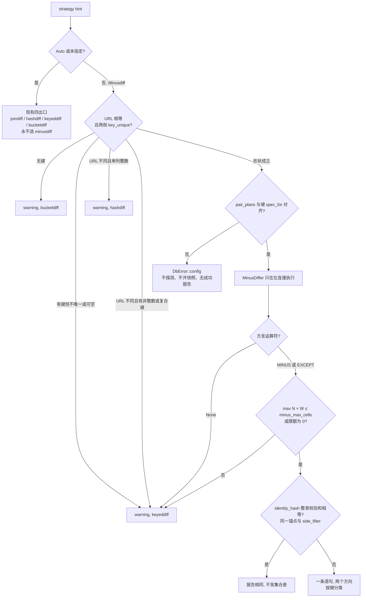
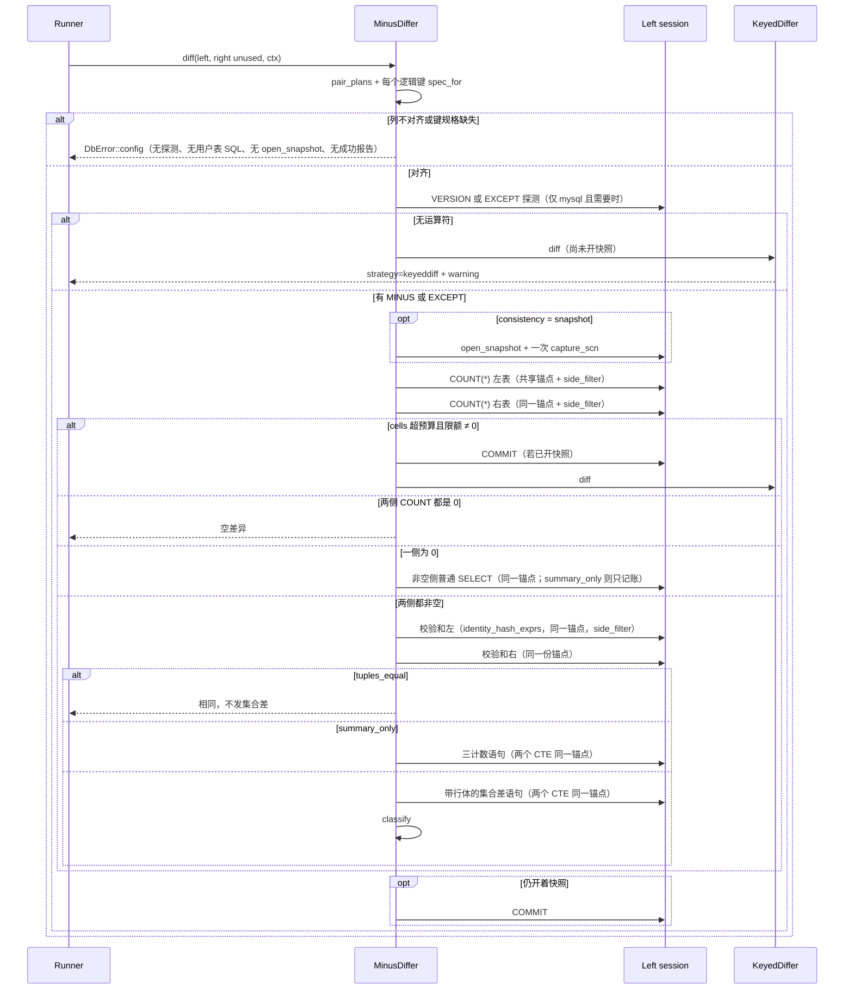

# delta-diff 策略 `minusdiff`：同库集合差快路径

| 项 | 值 |
|---|---|
| 作者 | hepta-dbcli design |
| 日期 | 2026-11-04 |
| 状态 | Draft（2026-11-04 评审修订；同日按实现前审核补 7 条小项） |
| 范围 | 设计 only。本文不实现策略 |
| 包 | `polar-mysql`（crate 根 `dbcli/`，二进制 `hepta_dbcli`） |
| 关联 | issue #130 路由、`docs/delta-diff 设计补充（scan-once 性能快路径）.md`（「不扩展 joindiff 多列 ON」仍有效） |

本文是《delta-diff 设计文档（修订版 v2.1）》与既有补充的**新增补充**。实现时另写短文 `docs/delta-diff 设计补充（minusdiff 使用说明）.md`，**不改** v2.1 正文。两份文件不要混用：本文是策略设计（路由、SQL、失败语义、PR 计划）；使用说明只给操作者看命令、运算符和限制。

> **2026-11-04 实现补充：** 下文多处写的「v1 auto 不选 minusdiff」已被使用要求取代。现行 auto 见文末「Auto 提升」。显式策略、唯一键闸门、不发 `ALL`、不扩展 joindiff 多列 `ON` 仍然有效。PR5 的估计行数闸门和「MySQL 不在 auto 里探测」没有照原样落地。

---

## Overview

同一条连接 URL 上的两张表，集合差运算符（Oracle `MINUS`，其它方言 `EXCEPT`）可以在**一次语句、一个快照**里只把差集送出服务器。用户要的就是这条路径，策略名固定为 `minusdiff`。它**不是**「凡是同库就比现在的策略快」。

`MINUS` / `EXCEPT` 快，当且仅当：差集远小于表、替代方案会把大部分行拉回客户端、并且投影进集合运算符的宽度是「规范化键 + 一个行哈希」而不是整行。两边内容相同的宽表，现有 `keyeddiff` / `hashdiff` 用定宽聚合就能停；此时跑 `MINUS` 仍要为每行建哈希表，**更慢、更吃临时空间**。单列整数主键上，`joindiff` 可以用键做探测；`MINUS` 不能把主键当 join key，**不得替换** `joindiff`。

因此 v1：

- 只在用户显式传入 `--strategy minusdiff`（MCP `strategy=minusdiff`）时进入。
- `auto` 的四条出口不变（`bucketdiff` / `keyeddiff` / `joindiff` / `hashdiff`）。`iblt`、`naivediff` 仍只在显式选择时进入。
- 真正会发出集合差的形状是：URL 字符串相等、两侧 `TablePlan::key_unique` 都为真、方言能发出 `MINUS` 或 `EXCEPT`、单元格预算未超。
- 用户关心的空洞是：**同 URL、唯一的复合键或非整数键、中等基数、差异打散在 `keyeddiff` 的哈希桶里**。这条路径今天会把绝大多数行拉回来。`minusdiff` 只为这条路径服务，不改 `joindiff` 的 `ON`。

比较语义继续由 `Dialect::normalize_expr` 与 `Dialect::row_hash_expr` 定义，不用引擎裸等值。LOB/LONG/BFILE/JSON 仍在 `metadata::build_table_plan` 里排除，不进投影。

---

## Background & Motivation

### 当前路由

`dbcli/src/delta_diff/engine.rs` 的 `route_impl`（issue #130）在 `strategy_hint == None` 或 `Strategy::Auto` 时：

| 条件 | 策略 |
|---|---|
| 无键，或左右键无法配对 | `bucketdiff`（无键行内容多重集，无 `Modified`） |
| 有键但不是单列整数（复合、字符串、其它） | `keyeddiff` |
| 单列整数且 `left_url == right_url` | `joindiff`（五方言） |
| 单列整数且 URL 不同 | `hashdiff` |

`same_connection` 在 `dbcli/src/delta_diff/mod.rs` 与 `api.rs` 里按 **URL 字符串相等**写入 `DiffContext`。Oracle 跨 schema 仍是同一条 service URL，在范围内。MySQL 两个库是两条 URL（路径即 database），不在范围内。没有「同一主机不同 URL」的等价判断，本文也不加。

`iblt`、`naivediff` 只在显式 `--strategy` 时进入。显式策略形状不对时，`route_impl` **带 warning 回退**，不把命令打成 exit 2：`joindiff` 跨 URL 且单列整数回退 `hashdiff`（文案 `falling back to hashdiff`）；非单列整数回退 `keyeddiff` 或 `bucketdiff`（`keyed_or_bucket_fallback`）。

### 现有同库与有键策略实际在做什么

`JoinDiffer`（`join_diff.rs`）只使用左连接。MySQL 系是 `LEFT JOIN UNION ALL`，Oracle / GaussDB / DuckDB 是 `FULL OUTER JOIN`。行身份是**单列整数键**。内容相等是 `row_hash_expr(normalized_exprs)`。NULL 键用 `ROW_NUMBER()` 配对，避免笛卡尔积。子查询别名不写 `AS`（Oracle `ORA-00933`），统一 `) l`。`assemble` 的 `_sample_limit` **不用**，差行全部留在 `sample_diffs`。`join_diff` **不**调用 `open_snapshot`，也**不**走 `side_filter`：`--where` 读的是 `ctx.filter`，`--update-column` 被丢掉。本文把这两点当作 `joindiff` 的既有行为，**不在 minusdiff 里复制**，也不顺手改 `joindiff`。

`KeyedDiffer`（`keyed_diff.rs`）：两侧 `COUNT(*)`，空侧短路，`max(count) <= fetch_all_threshold`（默认 4096）则整表拉取后客户端归并；否则每侧一条 `GROUP BY MOD(key_hash, N)`，只对脏桶做 keyset。`summary_only` 且两侧 `key_unique` 且倾斜时走点查。可空键上 SQL `=` / `>` 会丢掉 NULL 键，这是 scan-once 补充里写明的限制。`key_unique` 的定义在 `metadata.rs`：键非空、每列 `NOT NULL`、主键或被非部分唯一索引覆盖。可空唯一索引允许多个 NULL，因此 `key_unique == false`。

`hashdiff` 是跨实例的范围校验和二分。`bucketdiff` 是内容多重集。`naivediff` 两侧全扫、客户端指纹归并，受 `naive_max_rows`（默认 200_000）限制；无键模式没有 `Modified`。

报告契约（`report.rs`）：`DiffStatus` 只有 `MissingLeft` / `MissingRight` / `Modified`。无键报告不得发明 `Modified`。`sql_patch.rs` 的 `UPDATE` 需要 `Modified` 行的**两侧 payload**，物理列名由 runner 在策略返回后调用 `stamp_side_column_names` 盖上。`sample` / MCP `sample_limit` 只裁终端或 MCP payload（`output.rs`、`sample::retain_sample`），不裁 `summary`。审计通道 `Channel::DeltaDiff` 的 detail 只有连接、表、策略，**没有行数据**。MCP `delta_diff` 只读；策略是字符串参数（`server.rs::parse_delta_diff_strategy`）。

### 痛点

scan-once 补充明确：**不扩展 joindiff 的多列 `ON`**。JOIN 的裸等值没有 `keyeddiff` 的 `cmp_key` / `CHAR` 补空语义（#130 review bug 1）。复合键或字符串唯一键、同库、差异打散在 `MOD(hash, N)` 桶上时，`keyeddiff` 的脏桶并集接近全表，网络和客户端内存都是 `O(N × W)`，而差集本身只有 `D` 行。这就是 `minusdiff` 要补的洞。

### 集合差什么时候真快

设过滤后行数 `N`，比对列数 `W`（含键），键列数 `K`，差行数 `D`，`keyeddiff` 桶数 `B = clamp(ceil(N / bisection_threshold), 1, 1024)`，`bisection_threshold` 默认 16384。

集合差**理论上**一次扫完、只传差集，下面这些前提缺一则不成立：

1. 两表对**同一条会话**可见（本文：URL 相等，语句发在左连接）。
2. 运算符是集合（`DISTINCT`）时，投影必须能唯一标识行。否则重复行被悄悄丢掉。
3. 要标出 `Modified`，投影里必须有**每一列键**，并且要做**两个方向**。单方向 `A MINUS B` 只有「左有右无」的整行，没有 `Modified`，也没有右行图像。SQL patch 需要两侧图像。
4. 进哈希表的宽度必须窄。对全列做 `MINUS` 时，临时空间是 `N × W`。校验和策略的聚合状态是定宽（`ChecksumTuple`：`count + 4 × u64`）。
5. 一条语句一个快照，**没有分片断点**。语句被杀掉就从头再来。外层 `LIMIT` / `FETCH FIRST` **不会**让服务器少算集合差（与今天 `joindiff` 的 `_sample_limit` 未使用是同一类限制）。

---

## Goals & Non-Goals

### Goals

- 新增显式策略 `Strategy::Minusdiff`，CLI `--strategy minusdiff`，MCP `strategy=minusdiff`。名字保持 `minusdiff`，即使发出的关键字是 `EXCEPT`。
- 同 URL、两侧唯一且非空的键、方言能力允许、单元格预算内：左连接一条语句完成两个方向的集合差，并标成 `MissingLeft` / `MissingRight` / `Modified`。
- 比较语义与 `keyeddiff` / `joindiff` / `hashdiff` 对齐到 `normalize_expr` + `row_hash_expr`，而不是引擎裸等值。
- 形状不对、能力缺失、超过预算：按 `joindiff` 的风格 **warning + 回退**，回退后的 `report.strategy` 是实际执行的策略名。
- 语句失败（语法、权限、`ORA-01790`、临时空间、超时）：用户可见的 `DbError`，exit 2，**不 panic，不在失败后自动改跑 `keyeddiff`**。
- 列对齐失败：`MinusDiffer::diff` 的第一步就是 `DbError::config`，在能力探测和 `open_snapshot` 之前，不发用户表 SQL，不计成功报告。
- 零差异时用整表 `identity_hash_exprs` 校验和停住，不建 `N` 行的集合哈希表。五元组相等只继承现有切片聚合契约，不是逐行证明。
- 新行为先有失败测试。不改已有人类测试的断言。

### Non-Goals

- 不实现代码（本文）。
- 不把 `auto` 改成 `minusdiff`。那是后续 PR，且有额外闸门（见 Rollout 与 PR5）。
- 不扩展 `joindiff` 的多列 `ON`，不改 `joindiff` 的 SQL、快照或 `side_filter` 行为。
- 不做 keyless / 非唯一键的 `EXCEPT ALL` 多重集。Oracle 没有 `MINUS ALL`。无键表继续 `bucketdiff` / 显式 `naivediff`。
- 不把 MySQL 跨库（两条 URL）做成同库。不比较「同一主机」。
- 不新增运行时依赖、`unsafe`、workspace crate、指标系统、断点格式。
- 不改 v2.1 设计文档正文。
- 不把 `--strict` 从 iblt 语义扩成 minusdiff 的回退开关。形状 / 能力 / 预算的回退与 `joindiff` 一样，不看 `--strict`。这是有意的，避免一条旗标两种意思。
- 不在热路径上对用户表做试探性 `MINUS`。MySQL 的能力探测只在**显式** `minusdiff` 且静态规则不够时，对 `SELECT 1 … EXCEPT SELECT 1` 做一次，不扫用户表。

---

## Proposed Design

### 总览



`MinusDiffer` 与 `JoinDiffer` 一样，`diff` 的 `right` 连接不发查询。右表用左会话的 `quote_table(schema, table)` 引用。

### 路由（`route_impl`）

`Strategy::Auto` 的 `match` **不增加分支**。显式 `Strategy::Minusdiff` 在执行前做形状判断，文案风格对齐现有 `falling back to …`：

| 形状 | 实际策略 | warning 必须包含的子串 |
|---|---|---|
| 键为空 | `bucketdiff` | `minusdiff`、`unique`、`falling back to bucketdiff` |
| 有键，但 `!lplan.key_unique \|\| !rplan.key_unique` | `keyeddiff` | `minusdiff`、`unique`、`falling back to keyeddiff` |
| URL 不同，且单列整数（`bisectable`） | `hashdiff` | `minusdiff requires same-connection; falling back to hashdiff` |
| URL 不同，有键但非 `bisectable` | `keyeddiff` | `same-connection`、`falling back to keyeddiff` |
| URL 相等，两侧 `key_unique`，不论键是不是单列整数 | `MinusDiffer` | 无回退 warning |

单列整数 + 同 URL + 显式 `minusdiff` **保持** `minusdiff`，不改写成 `joindiff`。与显式 `keyeddiff` 在可二分键上仍走 `keyeddiff` 相同：显式就是显式。帮助文案要写明：这种形状上 `joindiff` 才是走索引的快路径，`minusdiff` 会哈希全列。

`key_unique == false` 包括：无唯一索引的显式 `--key`、部分索引、任一键列可空。不另做全表 `COUNT(*) vs COUNT(DISTINCT key)` 来证明唯一。目录说不唯一就不发 `MINUS`。

`route_impl` 是同步的，没有连接，**不能**看 MySQL 版本，也没有行数。能力探测和单元格预算在 `MinusDiffer::diff` 里做。因此 dry-run 在形状通过时打印 `strategy : minusdiff`，并**对所有方言**加一条 route warning：`minusdiff checks capability and cell budget at execution; dry-run does not`。MySQL 的 `VERSION()` / `EXCEPT` 探测只是能力检查的一种；Oracle、GaussDB、DuckDB 同样要等执行期 `COUNT` 才知道会不会因预算回退。dry-run **不**发 `COUNT`、不发 `EXCEPT` 探测。这条 warning 不是 MySQL 专属。

`format_key_domain_line` 为 `minusdiff` 增加与 `keyeddiff` 相同的一行：`key domain : (not applicable — minusdiff)`。不要对它做 `MIN/MAX` 键域探测（那段只服务 `hashdiff` / `iblt` / `joindiff`）。

### 方言能力

在 `Dialect`（`dbcli/src/backend/mod.rs`）上加**带默认实现**的方法，避免改遍测试里的假 `Dialect`：

```rust
#[derive(Debug, Clone, Copy, PartialEq, Eq)]
pub enum SetDifferenceOp {
    /// 静态规则下不发出集合差关键字。
    None,
    /// Oracle `MINUS`（集合 / DISTINCT）。没有 `MINUS ALL`。
    Minus,
    /// `EXCEPT`（集合 / DISTINCT）。不是 `EXCEPT ALL`。
    Except,
}

fn set_difference_op(&self) -> SetDifferenceOp {
    SetDifferenceOp::None
}
```

| 方言 | `url_scheme` | 返回值 | 关键字 |
|---|---|---|---|
| `mysql/dialect.rs` `MySqlDialect` | `mysql` | `None` | 服务器相关，见下 |
| `oracle/dialect.rs` 与 `oracle_native/dialect.rs` | `oracle` | `Minus` | `MINUS` |
| `gaussdb/mod.rs` | `gaussdb` | `Except` | `EXCEPT` |
| `duckdb/dialect.rs` | `duckdb` | `Except` | `EXCEPT` |

`oracle` 与 `oracle_native` 各写一行相同的 override。集合差 SQL 只在 `minus_diff.rs` 里按 `SetDifferenceOp` 渲染一份，不在两个 Oracle 方言文件里各写一份 SQL。这和 scan-once 补充「两边 checksum SQL 保持同步」的意图一致，同步点改成「关键字枚举一致、SQL 单点渲染」。

GaussDB / openGauss 走本仓库的 PostgreSQL 协议（`current_schema()`、`$1`）。`EXCEPT` 在 PG 模式和 Oracle 兼容（A）模式都合法。`MINUS` 只在 A 模式是同义词，PG 模式会语法错误。**GaussDB 永远发 `EXCEPT`，不探测。**

DuckDB 有 `EXCEPT` / `EXCEPT ALL`，没有 `MINUS`。发 `EXCEPT`。

MySQL 族（含 PolarDB-X，同一 `MySqlDialect`）静态信息不够：

| `SELECT VERSION()` | 决定 |
|---|---|
| `is_polardbx_version`（大写含 `PXC`） | `None`。不探测。仓库里的 `is_polardbx_version` 匹配的是版本串里的 `PXC`（现有测试样例是 Percona XtraDB Cluster 风格，如 `5.6.29-PXC-…`），本仓库用它代表 PolarDB-X。拒绝范围是这些版本串，不是去解析「PolarDB-X」这几个字。PolarDB-X 多数没有 `EXCEPT` |
| 含 `MARIADB` 或含 `POLARDB`（且不是上面的 PXC 拒绝） | **探测**。版本号不能证明 rebase 点已经有 `EXCEPT` |
| 能解析出 `major.minor.patch`，且 `≥ 8.0.31`，并且不是 MariaDB / PolarDB / PXC | `Except`，不探测 |
| 能解析且 `< 8.0.31`（含 5.7、8.0.30） | `None`，不探测 |
| 解析失败 | 探测 |

探测语句（不碰用户表，记入 `queries_total`，`ctx.vlog` 打 `[sql]`）：

```sql
SELECT 1 AS c EXCEPT SELECT 1 AS c
```

空结果即支持。任何错误都是 `None`。探测发生在 `pair_plans` 通过之后、`open_snapshot` **之前**。配置错误不会走到这里。探测失败不打开事务。

`EXCEPT ALL` 不进入枚举。唯一键上，集合差与 `(规范化键, 行哈希)` 的多重集差相同。Oracle 发不出 `ALL`。混用两种运算符会让同一种策略在不同方言上含义不同。

### 执行顺序

`MinusDiffer::diff` 只在左连接上工作。第一步是 `pairing::pair_plans` 和键的 `spec_for` 检查（见「列对齐」），通过之后才探测方言。复用，不重写：

- `pairing::pair_plans`（`right_of_left[i]` 是左 `compare_columns[i]` 在右 `compare_columns` 里的下标）
- `hash_diff::open_snapshot` / `capture_scn`。`url_scheme == "mysql"` 时 `open_snapshot` **总是先** `SELECT VERSION()`。PolarDB-X（`is_polardbx_version` 且 `begin_snapshot_sql_polardbx()` 为 `Some`）接着发那两条：`SET TRANSACTION ISOLATION LEVEL REPEATABLE READ` 与 `START TRANSACTION READ ONLY`，然后返回。这是 **3** 条语句，不是 2 条。其它 MySQL 在这次 `VERSION()` 之后走 `begin_snapshot_sql()`（`START TRANSACTION WITH CONSISTENT SNAPSHOT, READ ONLY`），共 2 条。能力探测更早发出的 `VERSION()` 是另外一条，不与 `open_snapshot` 里的那次合并
- `checksum::run_checksum` / `tuples_equal`
- `metadata::TablePlan::identity_hash_exprs`（校验和的表达式列表；不是集合差的 `h`）
- `strategy::side_filter`（`--where` 与 `--update-column` / `--update-since`）
- `keyed_diff::parse_count`。**不**复用 `render_count_sql`：它没有 `AS OF SCN` 参数
- 回退时直接 `KeyedDiffer::diff`。它把 `report.perf.queries_total` **换成**自己从 0 数起的计数（`keyed_diff.rs` 在 `assemble` 之后赋值）。`MinusDiffer` 必须把已经发出的探测、`VERSION`、`COUNT`、校验和再加回去。然后往 `report.warnings` 追加原因。`report.strategy` 保持 `"keyeddiff"`
- `report::stamp_columns_from_plan`

`preflight` 已经跑过 `session_pin_sql`（MySQL 时区、Oracle NLS、GaussDB `TimeZone`）。`MinusDiffer` 不再 pin。



回退给 `KeyedDiffer` 之后，返回报告的 `queries_total` 是它自己的计数加上 `MinusDiffer` 已经发出的语句。`COMMIT` 仍然不加。列配置错误在上图第一条 `alt` 就返回，不进入探测，也不调用 `open_snapshot`。

与 `keyed_diff.rs` 相同：`diff_inner` 无论成功失败，只要本策略打开过快照，都 `COMMIT` 再返回错误，避免连接池上留下未结束的只读事务。回退给 `KeyedDiffer` 之前也必须先 `COMMIT`，否则它自己的 `open_snapshot` 会撞上已有事务。`COMMIT` 不计入 `queries_total`（与 `keyeddiff` 一致）。

`consistency=none` 时不开快照，也不调用 `capture_scn`。`COUNT`、校验和、集合差是不同语句，并发写入可以让它们互相矛盾。这与 `keyeddiff` 在 `none` 下的撕裂是同一类，不额外隐藏。`snapshot`（CLI 默认）时这些语句共享左会话的一个只读事务：

| 方言 | `open_snapshot` 实际发出的语句 |
|---|---|
| MySQL（非 PXC） | `SELECT VERSION()`，然后 `START TRANSACTION WITH CONSISTENT SNAPSHOT, READ ONLY`（2 条） |
| PolarDB-X | `SELECT VERSION()`，然后 `SET TRANSACTION ISOLATION LEVEL REPEATABLE READ`，然后 `START TRANSACTION READ ONLY`（3 条）。显式 `minusdiff` 在能力阶段就拒绝 PXC，这条计数只在回退后的 `KeyedDiffer` 自己的 `open_snapshot` 里发生，并算进它的计数 |
| Oracle | `SET TRANSACTION READ ONLY`（1 条） |
| GaussDB | `BEGIN TRANSACTION ISOLATION LEVEL REPEATABLE READ READ ONLY`（1 条） |
| DuckDB | `BEGIN TRANSACTION`（1 条） |

### 一个共享快照锚点

`capture_scn` 只在左连接上调用一次。非 Oracle 的 `snapshot_scn_sql()` 是 `None`，函数直接 `Ok(None)`，不发查询。Oracle 是 `SELECT CURRENT_SCN FROM V$DATABASE`；查询失败（含 `V$DATABASE` 权限不足）是 `Err`，与 `keyeddiff` 一样用 `?` 传出，**不**吞成 `Ok(None)`，也不改走「只有事务、没有 SCN」的静默路径。行能解析成数字才是 `Some(n)`；解析不出是 `Ok(None)`。

`SELECT CURRENT_SCN` 可以读到比 `SET TRANSACTION READ ONLY` 更新的 SCN。`keyeddiff` 仍然一致，是因为之后每一条读都带这个 SCN，不只是校验和。因此 `minusdiff` 禁止「校验和走 `AS OF SCN`、集合差只靠事务」。锚点只有一个数：

- `Ok(None)`：`COUNT`、两侧校验和、空侧 `SELECT`、两个集合差 CTE **都不**写 `AS OF SCN`。只读事务是唯一读视图。
- `Some(n)`：上述每一条都写 **同一个** `AS OF SCN n`。禁止只写在校验和上。

两张表都在左会话里读，所以这个数写入 `ctx.scns` 的**左右两个槽**（`set((scn, scn))`）。不要对右连接再 `capture_scn`，也不要让 `scn_of(false)` 是 `None` 而 `scn_of(true)` 是 `Some`。`render_checksum_sql` 只在 Oracle 方言把 `spec.scn` 渲染成 `AS OF SCN`；MySQL / GaussDB / DuckDB 忽略该字段。集合差 CTE 与 `COUNT` 同样只在 `url_scheme == "oracle"` 且 `scn` 为 `Some` 时写出子句，避免在 MySQL 上生成非法语法。子句位置与现有校验和一致：`FROM <quoted table> AS OF SCN n`，然后才是 `WHERE`。

不在两个读视图之间做短路。校验和相等可以跳过集合差，仅当这条校验和 SQL 与本会发出的集合差 SQL 使用同一锚点、同一 `side_filter`。

右连接不开快照、不发 SQL。同一 URL 意味着同一套凭据；左会话看不见右表时，右会话也看不见。不把 `hydrate` 改成单连接。

### 为什么先校验和再集合差

短路用的列表**不是**集合操作数里的 `h`。

`ChecksumTuple`（`checksum.rs`）是 `COUNT(*)` 加四个 `SUM` 切片，切片是行哈希对 2^64 取模。`tuples_equal` 只比较这五元组。它不是「逐行 MD5 相等」，也不是「`(规范化键, 行哈希)` 集合相等」的证明。不同行可以拼出同一个 `'#'` 连接串，切片和可以碰巧相等。这是仓库已有的聚合契约，`minusdiff` 继承，不另写一套哈希。

每侧 `ChecksumSqlSpec` 按 `keyed_diff::batch_spec` 取表达式和谓词，但做成**整表一条元组**，不按桶 `GROUP BY`：

| 字段 | 值 |
|---|---|
| `normalized_exprs` | 该侧 `TablePlan::identity_hash_exprs`。先是 `key_hash_exprs`（每个键的 `normalize_expr`，`spec_for` 失败则 `quote_catalog_ident`），然后是 `norm_specs` 里名字不是键的列。`--columns` / `--exclude-columns` 把键移出 `norm_specs` 时，键仍在这份列表里 |
| `key_hash_exprs` | 该侧 `key_hash_exprs`。`bucket` 为空时 `render_checksum_sql` 的切片仍只哈希 `normalized_exprs`，所以键必须已经在 `identity_hash_exprs` 里，不能只填 `key_hash_exprs` |
| `filter` | `side_filter(ctx, scheme)`。与 CTE 的 `WHERE` 是同一谓词。不读裸 `ctx.filter` |
| `scn` | 上一节的共享锚点。两侧 spec 用同一个 `Option<u64>` |
| `key_column` / `range` / `bucket` | 全部留空。这不是 `keyeddiff` 的按桶聚合 |

`render_checksum_sql` 把 `normalized_exprs` 用 `'#'` 接起来再做行哈希，然后 `COUNT(*)` 与四个切片和。整表元组比按桶聚合更弱：桶把碰撞限制在一个键哈希桶里，整表则把所有行加进同一组切片和。接受这个残余，不因此改去逐行比较。

集合差操作数的 `h` **仍然**是 `row_hash_expr(该侧 norm_specs)`，与 `joindiff` 相同。被排除的键不进内容哈希。两份列表故意不同：短路要拦住「键还在、值对调」；`Modified` 的内容相等只看比较列。

反例（脚本测试必须失败于「报 identical」）：键不在 `norm_specs`。左 `(k=1, v=a), (k=2, v=b)`，右 `(k=1, v=b), (k=2, v=a)`。只哈希 `v` 时两侧值的多重集相同，`tuples_equal` 为真，会跳过非空集合差。`identity_hash_exprs` 把键放在值前面，两侧切片输入不同，报告必须是 `Modified`，并且必须发出集合差语句。

- **相同的宽表**：校验和状态是 `O(1)` 内存。`MINUS` 即使最后返回 0 行，也要为 `N` 个键建哈希或排序，可能把临时表打满。这一步是为了**不比 `keyeddiff` 的「桶校验和全匹配则停止」更差**，不是为了声称 `MINUS` 更快。CPU 上两者都要读全列并做哈希；差别在内存和临时空间。相等只说明五元组相同，不是逐行证明。
- **确有差异**：多付一次全列哈希扫描，然后集合差再哈希一遍 `(键, 行哈希)`。这是用一次额外扫描，换「只传 `D` 行」而不是「脏桶接近 `N` 行」。用户要的打散差异场景赚得回来；已知几乎全表都不同的场景，显式 `minusdiff` 会比直接 `keyeddiff` 多一次扫描。本文不提供「跳过校验和」的旗标，避免再加一个未测量的开关。

空侧在校验和之前短路：两侧 0 直接相同；一侧 0 则 `Missing*` 数量等于另一侧 `COUNT`，不发集合运算符。非 `summary_only` 时对非空侧发一条普通 `SELECT`（裸键 + 非键 `normalize_expr`，`side_filter`，以及同一个 `AS OF SCN` 规则），不走 `MINUS`。这条 `SELECT` **没有** `side` 列，投影是 `[rk0..rk{K-1}, c0..c{V-1}, k0..k{K-1}]`。送进 `classify_minus_rows` 之前，调用方给每一行前插一个常量 side：左表为空插 `"R"`，右表为空插 `"L"`。插完后的布局与集合差结果相同（`[side, rk…, c…, k…]`），不另写分类函数。`summary_only` 不发这条 `SELECT`，只把非空侧的 `COUNT` 记成对应的 `missing_*`。

`left_total` / `right_total` 取这条带锚点、带 `side_filter` 的 `COUNT(*)`。校验和里的 `count` 与之使用同一谓词、同一锚点；不等只可能是 `consistency=none` 下的并发写，或渲染错误。不等则追加 warning，`summary` 的总量改用校验和的 `count`，因为它和切片用的是同一条 `render_checksum_sql`。差行计数始终来自分类结果或 `summary_only` 的三个计数，不用来替换总量。`diff_rate` 与 `join_diff::assemble` 相同：`(missing_left + missing_right + modified) / max(left_total, right_total)`，分母为 0 时是 `0.0`。

### SQL 形状

两个方向在**一条语句**里，保证集合差本身只有一个读快照。集合运算的操作数只有规范化键和行哈希。行体放在 CTE 里，集合差之后按键 join 回来。这样哈希表的宽度是 `K` 个规范化键加一个摘要，而不是 `W` 列原文。优化器仍可能物化带行体的 CTE；预算按 `W` 估算就是为了覆盖这个最坏情况。不能移植地强制 `MATERIALIZE` 提示，本文不发 hint。

投影规则（两侧列数必须相同，否则执行前就报错，见下）：

- `k{i}`：该侧键的 `normalize_expr`（`key_specs`，即使 `--exclude-columns` 把键移出了比较列）。逻辑顺序是 `ctx.key_columns`。物理名：左 `left_key_columns[i]`，右 `right_key_columns[i]`，用 `quote_catalog_ident`，不重新折叠大小写（issue #116）。
- `h`：`row_hash_expr(该侧 norm_specs 的 normalize_expr 列表)`。与 `joindiff` 的内容哈希输入一致。键被排除出比较列时，哈希不含键值，只含剩余比较列。这与「键只标识行、值比较被排除」的现有说明一致。
- `rk{i}`：裸键（`quote_catalog_ident`），**不**进入 `MINUS` / `EXCEPT` 的操作数。`CHAR` 补空若进了集合操作数，会和 `normalize_expr` 的 `RTRIM` 分裂同一行。
- `c{j}`：非键比较列的 `normalize_expr`。`j` 只是投影里的输出序号，**不是** `right_of_left` 的下标。`norm_specs` 与 `compare_columns` 对齐（`metadata.rs`：normalization specs, parallel to compare_columns），通常含键。循环用左 `norm_specs` 的下标 `i`（就是 `pair_plans` 用的左 `compare_columns` 下标）。`spec.name` 属于 `key_columns` 则跳过，不生成 `c*`。否则左 CTE 取 `normalize_expr(left.norm_specs[i])`，右 CTE 取 `normalize_expr(right.norm_specs[right_of_left[i]])`。`right_of_left[i]` 必须是 `Some`，否则列对齐已经返回 `DbError::config`。`stamp_columns_from_plan` 只按左计划命名，不能把点错的右表达式改回来。

反例：左比较列 `[id, a, b]`，`id` 是键，`a` 的下标是 1。`right_of_left[0]` 指向右表的 `id`，不是 `a`。若用过滤后的非键序号 `j` 去索引 `right_of_left`，`c0` 会接到键表达式上。此时两侧 `c` 列数仍相同，`unmatched_*` 与 `ambiguous` 仍为空，配置检查不响，`Modified` 会比错列。渲染测试必须把键放在非首列，并让右表物理顺序不同，断言 `c0` 是配对后的值表达式，不是键表达式。

`normalize_expr` 对可空列包 `COALESCE(..., '<NULL_SENTINEL>')`。哨兵是 `backend/mod.rs` 的 `NULL_SENTINEL`（`\u{1f}NULL\u{1f}`）。碰撞风险是**全部策略已有的契约**，不是 `minusdiff` 新引入的。不要在集合差里再写一遍哨兵。

LOB/JSON/LONG/BFILE 在建计划时 `normalize_expr` 返回 `Err`，列不在 `norm_specs` 里，SQL 不得出现这些标识符。

#### Oracle（`SetDifferenceOp::Minus`）

复合键 `K_A`、`K_B` 与值列 `V`。表达式以真实 `normalize_expr` / `row_hash_expr` 为准（`TO_CHAR` 标度掩码、`STANDARD_HASH` 或 `DBMS_CRYPTO.HASH`）。下面只固定形状：

```sql
WITH l AS (
  SELECT <norm(K_A)> AS k0,
         <norm(K_B)> AS k1,
         <row_hash(norm_specs)> AS h,
         "K_A" AS rk0,
         "K_B" AS rk1,
         <norm(V)> AS c0
  FROM "LEFT_SCHEMA"."T_LEFT"
  WHERE (<side_filter>)
),
r AS (
  SELECT <norm(K_A)> AS k0,
         <norm(K_B)> AS k1,
         <row_hash(norm_specs)> AS h,
         "K_A" AS rk0,
         "K_B" AS rk1,
         <norm(V)> AS c0
  FROM "RIGHT_SCHEMA"."T_RIGHT"
  WHERE (<side_filter>)
),
ld AS (
  SELECT k0, k1, h FROM l
  MINUS
  SELECT k0, k1, h FROM r
),
rd AS (
  SELECT k0, k1, h FROM r
  MINUS
  SELECT k0, k1, h FROM l
)
SELECT side, rk0, rk1, c0, k0, k1
FROM (
  SELECT 'L' AS side, l.rk0 AS rk0, l.rk1 AS rk1, l.c0 AS c0, l.k0 AS k0, l.k1 AS k1
  FROM ld
  JOIN l
    ON (ld.k0 = l.k0 OR (ld.k0 IS NULL AND l.k0 IS NULL))
   AND (ld.k1 = l.k1 OR (ld.k1 IS NULL AND l.k1 IS NULL))
   AND (ld.h = l.h OR (ld.h IS NULL AND l.h IS NULL))
  UNION ALL
  SELECT 'R', r.rk0, r.rk1, r.c0, r.k0, r.k1
  FROM rd
  JOIN r
    ON (rd.k0 = r.k0 OR (rd.k0 IS NULL AND r.k0 IS NULL))
   AND (rd.k1 = r.k1 OR (rd.k1 IS NULL AND r.k1 IS NULL))
   AND (rd.h = r.h OR (rd.h IS NULL AND r.h IS NULL))
) d
ORDER BY k0, k1
```

约束：

- 关键字是 `MINUS`，SQL 中不得出现 `EXCEPT`。
- `FROM` 子查询不写 `AS`（禁止 `) AS l`、`) AS d` 这种表别名 `AS`）。CTE `WITH l AS (` 是 Oracle 允许的，不是 `ORA-00933` 的那种 FROM 别名。
- `ORDER BY` 只出现在最外层。`MINUS` 的两个操作数内部不得有 `ORDER BY`。
- `WHERE` 来自 `side_filter`，两侧同一方言同一谓词，并且括号包住。增量窗口因此是 `SYSDATE - n`，不是 MySQL 的 `DATE_SUB`。
- 不写 `LIMIT`、`FETCH FIRST`、`ROWNUM`。
- 共享锚点为 `Some(n)` 且 `url_scheme == "oracle"`：两个 CTE 的 `FROM` 都写 `AS OF SCN n`，位于 `WHERE` 之前，两处的 `n` 相同。`None` 或非 Oracle：两处都不出现 `AS OF SCN`。`summary_only` 的两个 CTE 遵守同一条。

#### MySQL / GaussDB / DuckDB（`SetDifferenceOp::Except`）

同一棵 CTE，把两处 `MINUS` 换成 `EXCEPT`。不得出现关键字 `MINUS`。标识符引号用该方言的 `quote_ident` / `quote_table`（MySQL 反引号，GaussDB 与 DuckDB 双引号）。`row_hash_expr` 分别是 MySQL `MD5(CONCAT_WS('#', …))`、GaussDB / DuckDB 各自现有实现。MySQL 8.0.31 已有 CTE（8.0 起就有），探测通过才发这棵语句。

`summary_only` 不选行体。Oracle 用 `FROM dual`，其它方言不要 `dual`：

```sql
WITH l AS (
  SELECT <norm keys> AS k0, …, <row_hash> AS h
  FROM <left>
  WHERE (<side_filter>)
),
r AS (
  SELECT <norm keys> AS k0, …, <row_hash> AS h
  FROM <right>
  WHERE (<side_filter>)
),
ld AS (
  SELECT * FROM (
  SELECT k0, k1, h FROM l
  MINUS -- 或 EXCEPT
  SELECT k0, k1, h FROM r
) setdiff
),
rd AS (
  SELECT * FROM (
  SELECT k0, k1, h FROM r
  MINUS
  SELECT k0, k1, h FROM l
) setdiff
)
SELECT
  (SELECT COUNT(*) FROM ld d
    WHERE NOT EXISTS (
      SELECT 1 FROM rd e
      WHERE (d.k0 = e.k0 OR (d.k0 IS NULL AND e.k0 IS NULL))
        AND (d.k1 = e.k1 OR (d.k1 IS NULL AND e.k1 IS NULL))
    )) AS missing_right,
  (SELECT COUNT(*) FROM rd d
    WHERE NOT EXISTS (
      SELECT 1 FROM ld e
      WHERE (d.k0 = e.k0 OR (d.k0 IS NULL AND e.k0 IS NULL))
        AND (d.k1 = e.k1 OR (d.k1 IS NULL AND e.k1 IS NULL))
    )) AS missing_left,
  (SELECT COUNT(*) FROM ld d
    WHERE EXISTS (
      SELECT 1 FROM rd e
      WHERE (d.k0 = e.k0 OR (d.k0 IS NULL AND e.k0 IS NULL))
        AND (d.k1 = e.k1 OR (d.k1 IS NULL AND e.k1 IS NULL))
    )) AS modified
FROM dual
```

`ld` / `rd` 先套一层不带 `AS` 的派生表 `setdiff`，再被三个标量子查询读取。MySQL 8.4 对同一条语句里被多次读取的 `EXCEPT` CTE 会算错行数（Bug #121239）；反连接还会返回 handler error 124，临时表落到 InnoDB 时在 `row0sel.cc` 断言 `key_len == DATA_ROW_ID_LEN` 并让 mysqld 退出。普通派生表把差集行复制出来之后，多次读取是安全的。行体语句每个差集只读一次，不套这层。

`summary_only` 的结果是一行三个计数。`sample_diffs` 为空。`modified_columns` 保持 `None`（直方图要逐格比较，与 `keyeddiff` 点查只记账、不物化一样）。`--summary-only` 与 `--export` 并存时，现有 `effective_summary_only` 已忽略前者并告警；SQL 导出仍走带行体的语句。不要在 `minusdiff` 里再发明一条优先级。

回连 `l` / `r` 取行体时，`ON` 是 NULL 安全的键相等，**再加** NULL 安全的 `h` 相等（`ld.h = l.h OR (ld.h IS NULL AND l.h IS NULL)`，右侧同理）。只按键回连时，目录撒谎或一侧同一个规范化键有两行，`(k, h1)` 会同时配上 `h1` 和 `h2`，在分类器报 `normalized key is not unique` 之前先叉积。加上 `h` 后，差集里的每一行在进分类器前就只配自己的那一行。`summary_only` 里 `ld` 与 `rd` 的 `EXISTS` **仍然只按键**：那两份已经是差集，同一个键两边哈希不同才是 `Modified`；若再要求 `h` 相等，一次修改会被拆成 `missing_right` 加 `missing_left`。

`key_unique` 已经要求键列 `NOT NULL`，正常计划不会有 NULL 键。目录撒谎或并发写入塞进 NULL 时，`=` 不会把 NULL 键笛卡尔积，也不会把它们当成「对不上」。分类器对 NULL 键仍按「只在一侧 → `Missing*`；两侧都在且内容哈希不同 → `Modified`」处理。若同一侧同一个规范化键出现多于一行，返回 `DbError::query`，文案含 `normalized key is not unique`，不猜配对。渲染测试 `rejoin_matches_row_hash_not_only_key` 锁定两侧 `ON` 都含 `h` 的 NULL 安全谓词。

### 分类与 payload

结果列布局：`[side, rk0..rk{K-1}, c0..c{V-1}, k0..k{K-1}]`。

按规范化键 `k*` 分组：

| 出现的 side | `DiffStatus` | payload |
|---|---|---|
| 只有 `L` | `MissingRight` | `left = [rk…, c…]`，`right = None` |
| 只有 `R` | `MissingLeft` | `right = [rk…, c…]`，`left = None` |
| 两侧都有 | `Modified` | 两侧都有，顺序都是左计划的逻辑列序 |

`DiffRow.key`：单列用标量 JSON，复合键用 JSON 数组。值来自**裸键** `rk*`，让驱动返回的数字仍是数字。这与 `keyeddiff` 的 `full_row_spec`（裸键 + 非键 `normalize_expr`）一致。`sql_patch::key_predicate` 因此可以对数字键写出数字字面量，对 JSON null 写出 `IS NULL`。

非键格是 `normalize_expr` 的文本，NULL 变成哨兵字符串。这是 `keyeddiff` / `joindiff` 已经写进报告的形状。`.sql` 导出会走现有 `hydrate::refill_raw_rows`（`export_rows_effective` 对 `.sql` 为真），把格换回裸列值。不在 `minusdiff` 里改 `sql_patch`。新增一条用构造报告调用 `render_sql_patch` 的测试，锁住「`strategy == minusdiff` 且 `Modified` 两侧都有 payload 时能渲染 `UPDATE`」。

`assemble` 调用 `stamp_columns_from_plan(&mut report, &ctx.left.plan)`。runner 随后调用现有 `stamp_side_column_names`。`row_payload = Columns`。`hash_algorithm = "md5"`。`shards` 一条，`shard_id = "minus"`。

`sample_limit` **不进入 SQL**。服务器仍会算完整集差；截断只发生在既有的终端 `--sample` 与 MCP `retain_sample`。把 `LIMIT` 加进唯一一条结果集会改掉 `summary` 计数，违反「`sample_limit` 不改变分类计数」。再发一条带 `LIMIT` 的语句等于把集合差算两遍，只省网络、不省临时空间，v1 不做。`ctx.sample_limit` 在 `MinusDiffer` 里故意不读，测试锁定两个不同的 `sample_limit` 得到同一个 `summary`。

### 单元格预算

`--minus-max-cells`，`u64`，`0` 表示不设上限。默认值只有一处：`dbcli/src/delta_diff/cmd.rs` 的 `pub(crate) const DEFAULT_MINUS_MAX_CELLS: u64 = 50_000_000`。CLI `default_value_t = DEFAULT_MINUS_MAX_CELLS`，MCP 缺省、`DiffOptions` 生产赋值、以及三个 `..Default::default()` 测试助手都引用这个常量，不把字面量再抄六遍。放在 `DiffContext` 与 `DiffOptions` 上，与 `fetch_all_threshold`、`naive_max_rows` 相同。`DiffOptions` 带 `#[derive(Default)]`，新增 `u64` 的派生默认值是 `0`（不限制）。因此不能靠 `..Default::default()` 得到 `DEFAULT_MINUS_MAX_CELLS`。手写的 `DiffContext { … }` 与 `DiffOptions { … }` 都要补上这个字段；**只补字段，不改断言**。穷尽字面量不补则不能编译。带 `..Default::default()` 的助手能编译，但必须显式写成 `minus_max_cells: DEFAULT_MINUS_MAX_CELLS`，否则预算被静默关掉。清单见 PR3。`--statement-timeout` 不是 `DiffContext` 字段：`execute_diff_inner` 在 `diff` 之前调用 `set_statement_timeout_sql`，Oracle 与 DuckDB 返回 `None`。不要把它加进 `DiffContext`。

```text
cells = max(left_total, right_total) × left.compare_columns.len()
```

宽度用比较列数而不是 `K + 1`，因为校验和与行哈希会读每一列，CTE 也可能把行体物化进去。集合运算符本身的哈希表更窄，预算是保守上界，不是 PGA 的精确模型。

| 例子 | cells | 默认 5×10⁷ |
|---|---|---|
| scan-once 补充里的 `dat_fund_cjqs`：450_000 行 × 53 列 | 23_850_000 | 允许 |
| 2_000_000 × 40 | 80_000_000 | 回退 `keyeddiff` |

超过预算且限额非 0：在发集合差**之前** `COMMIT`（若已开快照），warning：

```text
minusdiff cell budget exceeded: {cells} > {limit} (rows {n} × width {w}); falling back to keyeddiff. Pass --minus-max-cells 0 to force the set-difference.
```

然后 `KeyedDiffer`。`KeyedDiffer` 会再 `COUNT` 一次，可以接受。不要在已经超时或已经溢出临时表之后再回退。

### 列对齐

`MinusDiffer::diff` 的**第一步**，在 `VERSION()` / `EXCEPT` 探测和 `open_snapshot` 之前：

```text
pair_plans(&ctx.left.plan, &ctx.right.plan)
```

下列任一成立则 `DbError::config`，不发 SQL（含探测、用户表、MySQL 只读事务），不调用 `open_snapshot`，不回退，也不产生带 `queries_total` 的成功报告：

- `unmatched_left`、`unmatched_right`、`ambiguous` 非空
- 映射后两侧集合操作数的列数不同（按「投影规则」用下标 `i` 跳过键之后）
- 某个逻辑键在该侧 `spec_for` 找不到

文案列出 unmatched / ambiguous 的名字。回退到 `keyeddiff` 会按各自 `norm_specs` 的位置比较，错列时更安静地算错，所以这里用硬错误。`ORA-01790`（列数或并集类型不一致）在「两侧都是 `normalize_expr` 文本」时不该出现；若引擎仍返回 `ORA-01790` 或 `ORA-00932`，见失败模式，同样不回退。`c{j}` 的右表达式必须是 `right.norm_specs[right_of_left[i]]`，`i` 是左 `norm_specs` / `compare_columns` 的下标，不是过滤掉键之后的 `j`。

### 回退与 `report.strategy` / 审计

| 时机 | `report.strategy` | 进程 |
|---|---|---|
| `route_impl` 形状回退 | 回退策略名 | 继续做完比较 |
| 能力不足或超预算 | `"keyeddiff"` | 继续做完比较 |
| 列不对齐、集合差语句失败、结果里规范化键不唯一 | 无成功报告 | exit 2（`EXIT_ERROR`） |

CLI 审计的 start/outcome 今天记的是 `args.strategy` 原文（`mod.rs` 在路由**之前**取 `to_string()`），所以显式 `minusdiff` 即使回退，账本里仍是 `minusdiff`。`joindiff` 回退 `hashdiff` 已经是这样。本文**不改**审计字段，避免动到既有事件。账本继续只有连接、表、策略和耗时，没有行。

### 其它旗标

| 旗标 | `minusdiff` 行为 |
|---|---|
| `--where` / `--update-column` | `side_filter`，两侧同一谓词。不读裸 `ctx.filter` 而丢掉增量窗口 |
| `--columns` / `--exclude-columns` | 沿用计划。被排除的 LOB 不出现在 SQL 里。被排除的键仍是身份列 |
| `--consistency snapshot` | 左连接 `open_snapshot` + 结束时 `COMMIT` |
| `--consistency none` | 不开事务。允许撕裂 |
| `--recheck` | 不做。`recheck_diffs` 是当前读（`recheck.rs`），会偏离这一条集合差语句。`ctx.recheck` 为真时 warning：`minusdiff ignores --recheck: classification comes from one set-difference statement`。snapshot 默认把 `recheck_effective` 设为真，因此默认 snapshot 会看到这条 warning。这是有意和 `hashdiff` 不同 |
| `--checkpoint` | 不写分片。warning：`minusdiff does not record shard checkpoints; a cancelled statement restarts from scratch`。不因此 exit 2 |
| `--threads` | 忽略。一条会话一条语句。dry-run 仍打印用户传入的 threads，但不要打印 hashdiff 那种 `first-pass segs` |
| `--statement-timeout` | runner 在策略之前已经 `set_statement_timeout_sql`。MySQL `max_execution_time`，GaussDB `statement_timeout`，默认 300 秒。Oracle 与 DuckDB 的该方法返回 `None`，本旗标**不能**取消 Oracle/DuckDB 上的集合差。不新加 Resource Manager 调用 |
| `--verbose` | `ctx.vlog`：`[delta-diff] strategy=minusdiff consistency=… op=MINUS|EXCEPT keys=…`，以及每条 `[sql]`。不新增日志框架 |
| `--sample` / MCP `sample_limit` | 不进 SQL。分类计数是全量 |
| `queries_total` | 能力阶段的 `VERSION()`（若发过）+1，探测 `EXCEPT`（若发过）+1，两次 `COUNT`、两次校验和、集合差或 summary 或空侧 `SELECT` 各 +1。Oracle 的 `capture_scn`（`SELECT CURRENT_SCN FROM V$DATABASE`）发出则 +1。`open_snapshot` 按实际条数另加：非 PXC 的 MySQL 是 `VERSION` + `START` = 2；PolarDB-X 是 `VERSION` + `SET TRANSACTION` + `START TRANSACTION READ ONLY` = 3；Oracle / GaussDB / DuckDB 各 1。能力阶段的 `VERSION()` 与 `open_snapshot` 内部的 `VERSION()` 是两次，不合并。`COMMIT` 不加。回退时 `KeyedDiffer::diff` 会把 `queries_total` 写成自己从 0 数的值，`MinusDiffer` 把已经发出的条数加回去 |

### 性能对照

下表是设计判断，不是基准数字。`N` 行，`W` 列，`D` 差行，`B` 个 `keyeddiff` 桶。

| 场景 | joindiff | keyeddiff | hashdiff | bucketdiff | naivediff | minusdiff |
|---|---|---|---|---|---|---|
| 相同的宽表 | 仍要做 JOIN，但只传差异（为 0）。单列整数才能用 | 两侧窄聚合，桶全匹配则停。内存 `O(B)` | 跨库。两侧一条范围校验和即停 | 内容桶聚合，无行身份 | 把 `2N` 行拉回客户端，受 200_000 行顶 | 两次定宽校验和后**停止**，不发集合差。校验和是 `identity_hash_exprs` 的整表切片聚合，与集合差同一 `side_filter`、同一锚点。五元组相等不是逐行证明。与 keyeddiff 停住同量级，**不更快**。若去掉校验和直接 `MINUS`，会为 `N` 个键建哈希表，**更慢** |
| 同 URL、唯一单列整数、少量差异 | 键探测，一次 JOIN，只传 `D`。**auto 保持这条** | 可用，但不是 auto | 不用于同 URL auto | 不适用（有键不会 auto 进来） | 显式才进，拉全表 | 显式才跑。哈希全列，用不上主键索引。**不替换 joindiff** |
| 同 URL、唯一复合或字符串键、差异打散在各桶 | 明确不做多列 `ON` | 脏桶并集接近 `N` 行时，网络 `O(N × W)` | 不接受这种键 | 多重集，无 `Modified` | `N ≤ naive_max_rows` 时拉全表；更大直接拒绝 | **这是目标场景**。校验和发现不等后，集合差只传 `D` 行。多一次全列哈希扫描。`D ≪ N` 且桶几乎全脏时快于 keyeddiff |
| 巨大宽表 | 单列整数才适用；JOIN 仍要读全列 | 聚合定宽，脏桶才拉宽行 | 定宽摘要，可二分，可断点 | 定宽桶 | 默认拒绝（> 200_000） | 哈希表最坏 `N × W`（CTE 物化）或至少 `N × (K + 摘要)`。超 `minus_max_cells` 回退 keyeddiff。溢出临时表则失败，不回退 |
| 无键或有重复行 | 不接受 | 非唯一键会按排序配对；NULL 键被 `=` 丢掉 | 不接受 | 多重集，无 `Modified` | 无键多重集 | **拒绝**。Oracle `MINUS` 会丢掉重复行并少报。回退 keyeddiff 或 bucketdiff。不用 `EXCEPT ALL` |
| 快照 / 断点 / sample | 今天不开 `open_snapshot`；`_sample_limit` 不用；无断点 | 两侧快照；有 checkpoint 的是 hashdiff 路径，keyeddiff 的断点支持有限 | 区间断点 | 桶级 | 无断点 | 左连接一条只读事务包住多条语句。集合差语句本身不可断点。`LIMIT` 不减少服务器计算 |

`queries_total` 的期望量级（快照语句另计）：

- 相同且两侧非空：2 次 `COUNT` + 2 次校验和。没有集合差。
- 有差异且要行体：上面再加 1 条集合差。
- `summary_only` 且有差异：用 1 条三计数语句代替行体语句。
- 空侧：2 次 `COUNT`，外加至多 1 条非空侧 `SELECT`（`summary_only` 时连这条也不发）。

### 与 joindiff 的分界

`docs/delta-diff 设计补充（scan-once 性能快路径）.md` 的非目标第 2 条继续有效：**不扩展 joindiff 多列 `ON`**。`minusdiff` 不是那个 `ON` 的替代写法。它用集合差而不是 join 键匹配来找差集，键相等只用于把两侧差集行配成 `Modified`。单列整数同 URL 的 auto 出口仍是 `joindiff`。

---

## API / Interface Changes

### CLI

`dbcli/src/delta_diff/cmd.rs`：

```rust
pub(crate) enum Strategy {
    Auto,
    Hashdiff,
    Joindiff,
    Bucketdiff,
    Iblt,
    Keyeddiff,
    Naivediff,
    Minusdiff,
}
```

`Display` 产出 `"minusdiff"`。clap 帮助行改为：

```text
auto | hashdiff | joindiff | bucketdiff | iblt | keyeddiff | naivediff | minusdiff
```

新参数：

```rust
/// minusdiff：max(COUNT) × 比对列数超过此值则回退 keyeddiff。0 = 不设上限。
pub(crate) const DEFAULT_MINUS_MAX_CELLS: u64 = 50_000_000;

/// minusdiff：max(COUNT) × 比对列数超过此值则回退 keyeddiff。0 = 不设上限
#[arg(long, default_value_t = DEFAULT_MINUS_MAX_CELLS)]
pub minus_max_cells: u64,
```

不新增其它旗标。`--strict` 的帮助文案保持「只约束 iblt」。

### MCP

`server.rs`：

- `DeltaDiffParams::strategy` 的文档字符串加上 `minusdiff`。
- `parse_delta_diff_strategy` 接受 `"minusdiff"` → `Strategy::Minusdiff`。未知字符串仍是 `unknown strategy '{other}'`。
- 可选 `minus_max_cells: Option<u64>`。`None` 时用 `DEFAULT_MINUS_MAX_CELLS`。

MCP 仍只读。不新增工具。SQL patch 仍只在 CLI。

### `DiffContext` / `DiffOptions`

```rust
/// 0 = 不限制。默认 `DEFAULT_MINUS_MAX_CELLS`。
pub(crate) minus_max_cells: u64,
```

两处生产赋值都要带上这个字段：`api.rs::run_diff` 的 `DiffContext { … }` 读 `opts.minus_max_cells`；`mod.rs` 里 CLI 的 `DiffContext { … }` 读 `args.minus_max_cells`。`server.rs::build_mcp_diff_options` 的穷尽 `DiffOptions { … }` 同样要填：缺省或 `None` 用 `DEFAULT_MINUS_MAX_CELLS`。测试字面量见 PR3。只补字段，不改断言。

`MysqlSetOpDecision` 与 `SetDifferenceOp` 不是同一个枚举。映射只有这一条：`Refuse` 的结局与 `SetDifferenceOp::None` 相同（不发集合差，warning 后回退）；`Except` 对应 `SetDifferenceOp::Except`；`Probe` 不是运算符，探测成功变成 `Except`，探测失败变成 `None` 那条回退。`mysql_set_op_decision` **不会**返回 `SetDifferenceOp::Minus`。Oracle 的 `Minus` 只来自 `Dialect::set_difference_op`，不经过这个函数。

### `Dialect`

见上文 `SetDifferenceOp`。默认 `None`。四个真实方言 override。假方言不用改。

### 新模块

`dbcli/src/delta_diff/minus_diff.rs`，在 `delta_diff/mod.rs` 声明 `pub(crate) mod minus_diff`。

对外（crate 内）至少：

```rust
pub(crate) struct MinusDiffer;

pub(crate) enum MysqlSetOpDecision {
    Refuse,
    Except,
    Probe,
}

pub(crate) fn mysql_set_op_decision(version: &str) -> MysqlSetOpDecision;

pub(crate) fn render_minusdiff_sql(
    ctx: &DiffContext,
    dialect: &dyn Dialect,
    op: SetDifferenceOp,
    summary_only: bool,
    scn: Option<u64>,
) -> Result<String, DbError>;

pub(crate) fn classify_minus_rows(
    key_len: usize,
    value_len: usize,
    rows: &[Vec<Value>],
) -> Result<Vec<DiffRow>, DbError>;
```

`render_minusdiff_sql` 在列无法对齐时返回 `Err`，不返回带占位符的 SQL。`scn` 是共享锚点，函数不读 `ctx.scns`，纯测试不必填 `OnceLock`。调用方传入的值必须与当次 `COUNT` 和两份 `ChecksumSqlSpec.scn` 相同。Oracle 且 `Some` 时写进两个 CTE 的 `FROM`；其它情况 SQL 不含 `AS OF SCN`。

### 报告

无新字段。`strategy` 字符串为 `"minusdiff"` 或回退后的名字。`ShardResult.shard_id = "minus"`。

### 不改的接口

- `DiffStrategy` trait。
- `sql_patch`、`stamp_side_column_names`、`export`、审计 detail 的形状。
- `auto` 的四条出口。
- `joindiff` / `keyeddiff` 的 SQL。

---

## Data Model Changes

无表结构、无迁移、无 checkpoint 格式变化。`minusdiff` 不写 `CheckpointManager`。

计划侧无新字段。`key_unique` 已由 `build_table_plan` 写入。路由只读它。

内存：差行全部留在 `sample_diffs`，与 `joindiff` 相同。超过 100_000 行时，`execute_diff_inner` 已有 warning，不新加帽。SQL patch 已有 `SQL_ROW_CAP = 100_000`。

---

## Alternatives Considered

### 1. 裸列 `SELECT * … MINUS SELECT *`

引擎等值，不是本仓库的比较契约。Oracle `CHAR` 补空、`''` 与 NULL、`NUMBER` 标度、时间戳精度都会和 `hashdiff` / `keyeddiff` / `joindiff` 不一致。LOB 还会直接进运算符（`ORA-00932`）。**拒绝。** 采用 `normalize_expr` 投影。哨兵碰撞是既有契约，写在风险里，不因此改回裸列。

### 2. 全列进 `MINUS`，不做 `(键, 哈希)` 窄投影

实现短，但临时空间是 `N × W`，宽表上比校验和策略更容易溢出。也仍然不能标 `Modified`，除非再按键 join。**拒绝全列操作数。** 保留 CTE 行体 + 窄集合差。

### 3. `EXCEPT ALL` 覆盖无键多重集

MySQL 8.0.31+、DuckDB、GaussDB 的 `EXCEPT ALL` 可以表达 `naivediff` 的多重集差，并且只传差集。Oracle 没有 `MINUS ALL`。同一策略名在 Oracle 上会少报重复行。无键结果也不能标 `Modified`，SQL patch 不能写空 `WHERE`。**拒绝放进 v1。** 无键继续 `bucketdiff`（auto）和 `naivediff`（显式）。

### 4. 用 `minusdiff` 替换同 URL 单列整数的 `joindiff`

`MINUS` 哈希每一列，不能把主键当 join key。`joindiff` 已经是五方言的同库整数键路径，并且处理了 NULL 键窗口。替换会在「几乎相同的大整数主键表」上退步。**拒绝。** auto 不改；显式 `minusdiff` 在这种形状上仍允许，但是用户自己选的。

### 5. 能力不足或超预算时 exit 2，而不是回退

显式点名 `minusdiff` 的人可能希望「做不到就失败」。这和 `joindiff` / `hashdiff` / `iblt` 的形状回退不一致，也会让同一条 CLI 在 PolarDB-X 上 exit 2、在 Oracle 上 exit 0/1。**拒绝作为默认。** 语句已经失败（权限、语法、临时空间、超时、类型）才 exit 2，因为再跑 `keyeddiff` 会把负载做两遍，而且可能再次打满临时表。

### 6. auto 在 v1 就走 `minusdiff`

`route_impl` 没有行数，也没有版本。MySQL 能力探测若放进 auto，每次复合键比较都多一次往返，PolarDB-X 上还会多一次必然失败的语句。相同宽表若跳过校验和直接 `MINUS`，比现在的 `keyeddiff` 更吃临时空间。**v1 不做 auto。** 后续 PR 的闸门见 PR5，并且**不得**修改 `auto_never_picks_iblt_or_naivediff_across_key_shapes` 等已有断言：那些 `plan()` 的 `key_unique` 是 `false`，新 auto 必须要求 `key_unique`，因此旧断言自然仍成立。

### 7. 外层 `FETCH FIRST` / `LIMIT` 实现 `sample_limit`

服务器仍会算完集合差，计数还会错，除非再全量算一遍。`joindiff` 已经把 `_sample_limit` 留空，显示层负责裁剪。**不把 LIMIT 写进 SQL。**

---

## Security & Privacy Considerations

`minusdiff` 只发 `SELECT` / `WITH` / 集合运算符，外加本仓库已经在用的只读事务语句（`START TRANSACTION`、`SET TRANSACTION`、`BEGIN`、`COMMIT`）。没有 DML、没有 DDL、没有 `SELECT … INTO`。

标识符只经过 `Dialect::quote_table` 与 `quote_catalog_ident`。用户 `--where` 仍是原样拼进括号，分号已由 `DeltaDiffArgs::validate` 拒绝。不新写消毒器。增量谓词继续由 `side_filter` 生成，字符串字面量已把 `'` 加倍。

左会话必须能 `SELECT` 两张表。做不到是权限或对象不存在错误，不是提权路径。MCP 的 `delta_diff` 仍是只读工具；`minusdiff` 不增加写入面。inline URL 的信任模型不变：调用方可以让服务器去连任意主机，但这是既有 `left_url` / `right_url` 的能力，不是本策略新开的。

审计保持 `Channel::DeltaDiff`，detail 只有右侧连接、表名、策略名。禁止把差行、SQL 文本或 `--where` 正文写入账本。`verbose` 的 `[sql]` 走 stderr，与今天相同，其中可能含 `--where`。不把 verbose 默认打开。

规范化投影把单元格值发到客户端（非 `summary_only` 时）。这与 `keyeddiff` 拉行相同，不是新的数据类别。`summary_only` 只回三个计数。

---

## Observability

不新增指标、不新增日志 crate。

- `ctx.vlog` / stderr：策略行（含 `op=MINUS` 或 `op=EXCEPT`）和每条 `[sql]`。
- `report.perf.queries_total`：见上表。
- `report.warnings`：回退原因、recheck 忽略、checkpoint 忽略、dry-run 未做能力与预算检查（所有方言）、校验和 `count` 与 `COUNT(*)` 不一致。
- `report.strategy` 与 `shards[0].shard_id`：区分「用户点了 minusdiff」和「实际跑了集合差」。审计仍记用户点的名字，排障时以报告里的 `strategy` 为准。
- 超时与临时空间：依赖引擎错误文本，不新增告警通道。MySQL / GaussDB 受已设置的语句超时约束；Oracle / DuckDB 不受 `--statement-timeout` 约束，这本身要写进用户文档。

---

## Failure Modes

所有路径都是 `Result` / `DbError`。库代码不用 `unwrap` / `expect` / `panic!` 做控制流。

| 失败 | 用户可见行为 | 是否回退 |
|---|---|---|
| 无键、键不唯一、URL 不同 | warning，`bucketdiff` / `keyeddiff` / `hashdiff`（见路由表） | 是，执行前 |
| PolarDB-X、旧 MySQL、探测失败 | warning，`falling back to keyeddiff`，子串 `no MINUS/EXCEPT` | 是，开快照之前 |
| `cells` 超预算 | warning，回退 `keyeddiff` | 是，集合差语句之前 |
| 列无法配对、键 `spec_for` 缺失 | `DbError::config`，exit 2，列出列名。在能力探测和 `open_snapshot` 之前，无成功报告 | 否 |
| `ORA-01790`、`ORA-00932`、`UNION types`、`incompatible types` | 前缀 `minusdiff: set operands are not union-compatible`，exit 2 | 否 |
| `ORA-00942`、`ORA-01031`、MySQL 1142/1044、`permission denied`、`does not exist` | 前缀说明左会话必须能 `SELECT` 左右两表（同 URL 不够，缺权限仍失败），exit 2 | 否 |
| `ORA-01652`、`ORA-01653`、临时文件 / `temp_file_limit` / `The table '%' is full` | 前缀 `minusdiff: set-difference failed (temp spill, timeout, or engine error); not retrying as keyeddiff`，exit 2 | 否 |
| MySQL `max_execution_time`、GaussDB `canceling statement due to statement timeout` | 同上，exit 2 | 否 |
| 结果中同一侧规范化键重复 | `normalized key is not unique`，exit 2 | 否 |
| 结果行宽不够 | `minusdiff: projection too short`，exit 2。对齐 `join_diff` 的 projection too short，不把半行当成 `Modified` | 否 |
| 快照语句失败 | 原错误返回，exit 2。不回退（`keyeddiff` 也会开快照，同样会失败） | 否 |
| Oracle / DuckDB 跑满挂起 | `--statement-timeout` 无效。只能靠预算和进程取消。文档写明 | 不适用 |

错误匹配用 `err.to_string()` 的大小写不敏感子串。匹配不到的引擎错误仍加前缀 `minusdiff: set-difference failed: ` 后返回，不吞掉。

---

## Risks

| 严重度 | 风险 | 缓解 |
|---|---|---|
| 高 | 唯一索引与数据不符（约束失效、并发重复），`MINUS` 少报重复行 | 只在两侧 `key_unique` 时发语句；结果侧再拒绝重复规范化键。相同内容的重复行仍可能被 `DISTINCT` 吃掉。接受这个残余，不另扫一遍 `GROUP BY key HAVING COUNT(*) > 1` |
| 高 | CTE 把宽行体物化，PGA / `work_mem` / DuckDB 内存溢出 | 预算按 `N × W`；溢出不回退、不 panic；Oracle 无语句超时，文档写明 |
| 中 | 有差异时校验和 + 集合差是两次全列哈希 | 写进性能表。不声称所有同库比较都更快。不在 v1 加「跳过校验和」旗标 |
| 中 | MySQL 版本字符串装成 ≥ 8.0.31 但实际没有 `EXCEPT` | PolarDB 字样强制探测；PXC 直接拒绝；语句语法错误 exit 2，不把空差集当成成功 |
| 中 | `NULL_SENTINEL` 与真实单元格碰撞 | 继承 `normalize_expr`。不新做哨兵 |
| 中 | 集合差 `h` 的 MD5 碰撞把不同比较列看成相同 | 与 `joindiff` 相同，继承 `row_hash_expr(norm_specs)`。被排除的键本来就不进内容哈希 |
| 中 | 校验和短路把非空差集看成相同 | `normalized_exprs` 用 `identity_hash_exprs`。键被排除出 `norm_specs` 时仍在切片输入里，值对调不得短路。匹配的 `ChecksumTuple` 仍只是切片和与 `'#'` 拼接契约，不同行可以共享一个哈希串。这是既有聚合的残余，不另做逐行证明。脚本测试锁住「键在比较列外、值对调 → `Modified`」。锚点与 `side_filter` 和集合差相同，禁止只给校验和加 `AS OF SCN` |
| 中 | 默认 snapshot 下出现「忽略 recheck」warning，被当成失败 | 文案写成 ignores，不写成 error。退出码仍看有没有差异（0 / 1），不看这条 warning |
| 低 | `DiffContext` / `DiffOptions` 增字段导致测试字面量要改 | 只加字段，显式默认 `DEFAULT_MINUS_MAX_CELLS`。派生 `Default` 的新 `u64` 是 `0`，`..Default::default()` 的助手也要写上。禁止改断言来编译通过 |
| 低 | dry-run 显示 `minusdiff`，执行时因能力或预算回退（所有方言，不只 MySQL） | route warning：`minusdiff checks capability and cell budget at execution; dry-run does not` |

---

## Rollout Plan

没有独立 feature flag。开关就是策略名，默认 `auto` 不进入。

1. 合入方言枚举与纯函数（无用户可见行为）。
2. 合入显式 `minusdiff` 执行路径。默认命令的路由测试必须原样通过。
3. 文档更新 UserGuide、README、短补充。不改 v2.1 正文。
4. 回滚：还原这些提交即可。没有迁移、没有新账本字段。已经发出的 CLI 若写了 `--strategy minusdiff`，回滚后 clap 会拒绝该枚举值（exit 2）。这是可接受的，因为没有默认流量。
5. auto 提升**不是**本设计的上线条件。见 PR5。在 PR5 之前，同 URL 复合唯一键的 auto 仍是 `keyeddiff`。

`--minus-max-cells 0` 是给已经确认临时空间够用的人用的强制阀，不是默认。

---

## Test Plan

风格：源文件内 `#[cfg(test)]`，显式断言，不用 `insta`，不新增依赖。不把已有测试改成 `is_ok()`。不要求单元测试连 Oracle。`#[cfg(feature = "duckdb")]` / `gaussdb` / `oracle` 与 `join_diff.rs` 的方言测试相同。

直播库集成测试不是 v1 门槛。仓库已有 `tests/regress_*.rs`（`integration` feature）。若以后加，只加新测试，不改旧断言；MySQL 8 才有 `EXCEPT`，旧服务器应跳过而不是失败。v1 PR 可以不带集成测试。

### 路由（`engine.rs`，新测试）

- `auto_same_url_unique_composite_key_stays_keyeddiff_not_minusdiff`
- `explicit_minusdiff_same_url_unique_composite_key_stays_minusdiff`
- `explicit_minusdiff_same_url_unique_string_key_stays_minusdiff`
- `explicit_minusdiff_same_url_integer_key_is_not_rewritten_to_joindiff`
- `explicit_minusdiff_cross_url_integer_falls_back_to_hashdiff`
- `explicit_minusdiff_cross_url_composite_falls_back_to_keyeddiff`
- `explicit_minusdiff_keyless_falls_back_to_bucketdiff`
- `explicit_minusdiff_non_unique_key_falls_back_to_keyeddiff`
- `explicit_minusdiff_nullable_key_falls_back_to_keyeddiff`（`key_unique: false`）

已有 `auto_routes_joindiff_same_url_each_dialect`、`auto_never_picks_iblt_or_naivediff_across_key_shapes` **不改**。新测试的 `plan()` 不要把现有 helper 的 `key_unique` 默认值从 `false` 改成 `true`。

### 方言

- `oracle_set_difference_op_is_minus`（`oracle` 与 `oracle_native` 都断言）
- `mysql_set_difference_op_is_none`
- `gaussdb_set_difference_op_is_except`
- `duckdb_set_difference_op_is_except`（feature `duckdb`）

### 纯函数

- `polardbx_version_refuses_without_probe`（`5.6.29-PXC-…` 与现有 `is_polardbx_version` 样例）
- `mysql_8_0_31_selects_except`
- `mysql_8_0_30_refuses`
- `mariadb_and_polardb_strings_ask_for_probe`
- `oracle_sql_emits_minus_not_except`
- `oracle_sql_order_by_is_outer_only_and_from_alias_has_no_as`
- `mysql_sql_emits_except_not_minus`
- `gaussdb_sql_emits_except`
- `duckdb_sql_emits_except`
- `where_pushdown_is_parenthesized_on_both_ctes`
- `incremental_day_predicate_uses_side_filter`（Oracle 含 `SYSDATE - 3`，MySQL 含 `DATE_SUB`）
- `lob_column_absent_from_projection`（计划 warning 里有 LOB，SQL 不含该列名）
- `set_operand_is_normalized_keys_and_row_hash_only`
- `minusdiff_sql_has_no_limit_fetch_or_rownum`
- `summary_only_sql_projects_three_counts_and_no_body`
- `null_safe_key_predicate_is_present`
- `rejoin_matches_row_hash_not_only_key`（回连 `l`/`r` 的 `ON` 含 NULL 安全的 `h`；`summary_only` 的 `ld`/`rd` `EXISTS` 仍只按键）
- `misaligned_columns_are_config_error`
- `right_value_uses_compare_index_not_non_key_index`（键不是第一列比较列；右表物理顺序不同；`c0` 是配对后的值表达式，不是键表达式）
- `oracle_scn_is_on_both_ctes_or_on_neither`（`Some(n)` 时两处 `FROM` 都含同一个 `AS OF SCN n`；`None` 或非 Oracle 时 SQL 不含 `AS OF SCN`）

### 分类

- `classify_left_only_as_missing_right`
- `classify_right_only_as_missing_left`
- `classify_both_sides_as_modified_with_both_payloads`
- `classify_null_key_pairs_as_modified_without_cartesian`
- `classify_duplicate_normalized_key_is_error`
- `classify_counts_do_not_depend_on_sample_limit`（两个 `DiffContext.sample_limit`，`summary` 相等，且 SQL 无 `LIMIT`）

### 脚本连接（仿 `join_diff.rs` 的 `ScriptedConn`）

- `identical_checksum_does_not_issue_set_difference`（校验和 SQL 的表达式列表含键，即 `identity_hash_exprs`，并且带 `side_filter`）
- `excluded_key_swapped_values_are_modified_not_identical`（键不在 `norm_specs`；值在两个键之间对调；报告是 `Modified`，并且发出了集合差）
- `empty_side_does_not_issue_set_operator`
- `over_cell_budget_falls_back_before_set_operator`
- `zero_cell_budget_disables_guard`
- `probe_failure_falls_back_to_keyeddiff_without_opening_user_minus`
- `fallback_queries_total_includes_statements_already_sent`（回退后的 `queries_total` 大于 `KeyedDiffer` 自己的计数，包含此前的探测或 `VERSION` / `COUNT`）
- `config_error_does_not_open_snapshot`（列不对齐时脚本连接看不到 `VERSION`、`EXCEPT`、`START TRANSACTION`、用户表 SQL）
- `oracle_count_checksum_and_set_diff_share_one_scn`（`Some(n)` 时 `COUNT`、两侧校验和、集合差 CTE 含同一个 `AS OF SCN n`；`None` 时这些语句都不含 `AS OF SCN`）

### CLI / MCP

- `strategy_minusdiff_parses`（`cmd.rs`）
- `parse_delta_diff_strategy_accepts_minusdiff`（`server.rs`）
- `dry_run_minusdiff_key_domain_is_not_applicable`
- `sql_patch_renders_update_for_minusdiff_modified_row`（构造报告，不连库）

### 命令

每个 PR 在红灯测试名上先跑：

```bash
cargo test --all <test_name>
```

合入前，与 `AGENTS.md` 一致：

```bash
cargo fmt --all -- --check
cargo clippy --all --all-targets
cargo test --all
```

PR1 改了 `Dialect`。`AGENTS.md` 要求动 `backend/mod.rs` 的 trait 时另跑：

```bash
cargo clippy --all --all-targets --features duckdb
cargo test --all --features duckdb
```

不跑 `cargo update`。不改 golden。无数据库时不要为了本设计去跑 `integration`。

---

## Documentation

实现 PR 更新，且只加不改写 v2.1 正文：

- `README.md` 策略表加一行：`minusdiff` 不是 auto 的选择；显式传入；同 URL；唯一键；Oracle 发 `MINUS`，MySQL 8.0.31+ / GaussDB / DuckDB 发 `EXCEPT`；单列整数同 URL 仍建议 `joindiff`。
- `UserGuide.md` 策略表与 MCP `strategy` 枚举同样加上 `minusdiff`，并写 `--minus-max-cells` 默认 `50000000`、`0` 为不限制、`sample` 不减少服务器计算、Oracle 上 `--statement-timeout` 约束不了这条语句、无断点。
- 新文件 `docs/delta-diff 设计补充（minusdiff 使用说明）.md`：给操作者的短补充，指向本文的路由表、运算符表和「不扩展 joindiff」。不要把 v2.1 或 scan-once 补充的正文搬进去重写。文件名带「使用说明」，与本设计文件 `（minusdiff 策略设计）.md` 区分。

---

## Open Questions

核心算法、路由、关键字、投影、预算和失败语义都已决定，不阻塞实现。

唯一可在上线测量后改的常量是 `cmd.rs` 的 `DEFAULT_MINUS_MAX_CELLS`（当前 `50_000_000`）。它是 `N × W` 的保守上界，不是实测 PGA。用 scan-once 补充里的量级（约 45 万行 × 53 列，低于该默认值）做一次 Oracle 临时表观察之后，只改这一处常量，以及断言「默认值等于该常量」的测试。不要在 CLI、MCP 和测试助手里各改一个字面量。改常量不是改运算符，也不是改 auto。

---

## References

- `dbcli/src/delta_diff/engine.rs`：`route_impl`、`keyed_or_bucket_fallback`、issue #130 测试
- `dbcli/src/delta_diff/strategy.rs`：`DiffContext::same_connection`、`side_filter`
- `dbcli/src/delta_diff/join_diff.rs`：单连接、`ORA-00933`、未使用的 `_sample_limit`、NULL 键窗口
- `dbcli/src/delta_diff/keyed_diff.rs`：`COUNT`、空侧、`fetch_all_threshold`、`key_unique` 点查、`parse_count`、`batch_spec`（`identity_hash_exprs` + `side_filter` + `scn`）、`diff` 把 `queries_total` 从 0 写回
- `dbcli/src/delta_diff/metadata.rs`：`key_unique`、LOB 排除、`identity_hash_exprs`（键在 `norm_specs` 之外仍进入哈希）
- `dbcli/src/delta_diff/pairing.rs`：`right_of_left` 是「每个左 `compare_columns` 下标对应的右 `compare_columns` 下标」
- `dbcli/src/delta_diff/checksum.rs`：`run_checksum`、`tuples_equal`、`ChecksumTuple`（`count` + 四个切片和）
- `dbcli/src/delta_diff/hash_diff.rs`：`open_snapshot`（MySQL 先 `VERSION()`；PolarDB-X 再加两条事务语句）、`capture_scn`
- `dbcli/src/delta_diff/report.rs`、`sql_patch.rs`、`mod.rs` 的 `stamp_side_column_names`
- `dbcli/src/backend/mod.rs`：`Dialect`、`NULL_SENTINEL`、`normalize_expr`、`row_hash_expr`
- `dbcli/src/server.rs`：`parse_delta_diff_strategy`
- `docs/delta-diff 设计补充（scan-once 性能快路径）.md`：不扩展 joindiff 多列 `ON`
- `AGENTS.md`：TDD 与门禁命令

---

## Key Decisions

1. **v1 只做显式策略。** `auto` 四出口不动。`route_impl` 没有行数和服务器版本，无法安全地在 auto 里发 `MINUS`。用户要的性能空洞用 `--strategy minusdiff` 到达，而不是替换默认路径。
2. **名字永远是 `minusdiff`，关键字按方言。** Oracle（含 `oracle_native`）发 `MINUS`。GaussDB、DuckDB、MySQL 8.0.31+ 发 `EXCEPT`。不发 `EXCEPT ALL` / `MINUS ALL`。PolarDB-X 与旧 MySQL 不发集合差。
3. **MySQL 能力不靠扫用户表。** PXC 直接拒绝；`< 8.0.31` 直接拒绝；普通 MySQL `≥ 8.0.31` 直接 `EXCEPT`；MariaDB / PolarDB 字样才做 `SELECT 1 EXCEPT SELECT 1`。探测只在显式策略上，且在开快照之前。
4. **两侧 `key_unique` 才发语句。** 集合运算符会丢掉重复行。不唯一或可空则 warning 后回退 `keyeddiff`，不静默少报。无键回退 `bucketdiff`。这比 `joindiff` 更严：`joindiff` 不看 `key_unique`。有意不同，因为 `MINUS` 的错误是少报而不是多配。
5. **不替换 `joindiff`，不扩展它的 `ON`。** 显式 `minusdiff` 在单列整数同 URL 上可以跑，但 auto 仍是 `joindiff`。
6. **投影用 `normalize_expr` + `row_hash_expr`，不用裸列等值。** 集合操作数只有规范化键和行哈希；裸键与非键规范化值在 join 回来的外层，供报告和 SQL patch。LOB 继续排除。
7. **相同表先走整表校验和，相等则不发集合差。** 表达式是 `identity_hash_exprs`（键始终在内），`filter` 是 `side_filter`，SCN 与 `COUNT`、空侧 `SELECT`、两侧 CTE 是同一个锚点：Oracle 上这些语句都带同一个 `AS OF SCN n`，或者都不带、只靠只读事务。不在两个读视图之间短路。`tuples_equal` 为真只表示 `ChecksumTuple` 的 `count` 与四个切片和相同，不是逐行 MD5 相等。集合差操作数的 `h` 仍是 `norm_specs` 的 `row_hash_expr`，与这份校验和列表不同。有差异时多一次扫描，这是写明的代价，不是全面更快。避免「全表相同仍建 `N` 行哈希表」。
8. **同库 = URL 字符串相等，只使用左连接。** 与 `same_connection` 和 `joindiff` 一致。Oracle 跨 schema 可以。MySQL 两个 database 两条 URL，不行。
9. **形状、能力和预算：warning + 回退，对齐 `joindiff`。** 语句失败、列不对齐、结果键不唯一：exit 2，不回退。不把 `--strict` 复用到这里。
10. **预算默认 `max(N) × W ≤ DEFAULT_MINUS_MAX_CELLS`（`50_000_000`），`0` 关闭。** 数字只定义一次。超限在发集合差之前回退。临时空间溢出和超时不回退。
11. **`sample_limit` 不进 SQL。** 计数是全量。与 `joindiff` 的未使用参数同一限制，并用测试锁住，避免半截 `LIMIT` 改掉 `summary`。
12. **`summary_only` 是一条三计数语句**，不传行体。`--export` 优先的既有规则不动。
13. **recheck 不做，checkpoint 不写**，各有一条 warning。快照只包左连接，多条语句一个只读事务；`joindiff` 今天不开快照，这里有意不同，因为 `minusdiff` 不止一条读。
14. **不加依赖、不加 `unsafe`、不加 crate。** `Dialect::set_difference_op` 有默认实现，假方言不用改。
15. **不改已有 auto 测试断言。** 后续 auto PR 只能给 `key_unique == true` 的新测试开路口；旧 `plan()` 默认 `key_unique: false`，旧断言必须仍然成立。

---

## PR Plan

每个 PR 都按 Red → Green → Refactor。先加一个会失败的行为测试（断言失败或因缺少 API 不能编译都算红），再写最少实现，测试全绿后再在同一 PR 里做仅限本改动的重构。不跳过、不改写已有人类测试的断言。门禁命令只用 `AGENTS.md` 里的：

```bash
cargo test --all <test_name>
cargo fmt --all -- --check
cargo clippy --all --all-targets
cargo test --all
```

动到 `Dialect` 时额外：

```bash
cargo clippy --all --all-targets --features duckdb
cargo test --all --features duckdb
```

### PR1 — `Dialect::set_difference_op`

- **标题：** `Add Dialect::set_difference_op for MINUS versus EXCEPT`
- **文件：** `dbcli/src/backend/mod.rs`；`mysql/dialect.rs`；`oracle/dialect.rs`；`oracle_native/dialect.rs`；`gaussdb/mod.rs`；`duckdb/dialect.rs`
- **依赖：** 无
- **内容：** 增加 `SetDifferenceOp` 与带默认 `None` 的 trait 方法。Oracle 两个方言返回 `Minus`，GaussDB 与 DuckDB 返回 `Except`，MySQL 保持默认 `None`。只加枚举测试，不接 CLI。Refactor：确认假 `Dialect` 不用逐个实现。
- **红灯测试：** `oracle_set_difference_op_is_minus`、`mysql_set_difference_op_is_none`、`gaussdb_set_difference_op_is_except`、`duckdb_set_difference_op_is_except`
- **完成门禁：** fmt、clippy、`cargo test --all`，外加 duckdb feature 的 clippy 与 test

### PR2 — 纯 SQL 渲染与分类

- **标题：** `Render minusdiff set-difference SQL and classify key matches`
- **文件：** 新 `dbcli/src/delta_diff/minus_diff.rs`；`dbcli/src/delta_diff/mod.rs`（`mod` 声明）
- **依赖：** PR1
- **内容：** `mysql_set_op_decision`、`render_minusdiff_sql`（含 `scn: Option<u64>`）、`classify_minus_rows`。覆盖 Oracle `MINUS`、`EXCEPT`、外层 `ORDER BY`、禁止表别名 `AS`、`side_filter`、LOB 不出现、无 `LIMIT`、`summary_only` 三计数、NULL 安全谓词、回连 `ON` 含 NULL 安全的 `h`、列不对齐报错、`c{j}` 用比较列下标 `i` 而不是非键序号 `j`、Oracle `AS OF SCN` 要么在两个 CTE 上是同一个 `n` 要么完全不出现、分类四种结果、空侧行前插 `side` 后再分类。不注册策略，用户还点不到。Refactor：谓词拼接只留一个 `null_safe_eq` 帮助函数，避免两套 SQL 漂移。`MysqlSetOpDecision::Refuse` 只在注释里标明等价于不发集合差，不把它并进 `SetDifferenceOp`。
- **红灯测试：** Test Plan 里「纯函数」和「分类」两组，含 `right_value_uses_compare_index_not_non_key_index` 与 `oracle_scn_is_on_both_ctes_or_on_neither`。一次循环只加一个行为；本 PR 在评审上是一组纯函数，实现时仍按一个断言一轮红绿推进，不要一次写完再补测试。

### PR3 — 显式策略执行

- **标题：** `Run explicit minusdiff on the left session`
- **文件：** `cmd.rs`、`engine.rs`、`minus_diff.rs`、`strategy.rs`、`api.rs`、`mod.rs`（CLI `DiffContext` 赋值、dry-run 键域行）、`server.rs`。所有手写 `DiffContext { … }` 只增加 `minus_max_cells`。`DiffOptions` 字面量同样只加这一字段，不改断言：
  - 穷尽、缺字段则不能编译：`api.rs` 的 `opts`（`joindiff_opts` 调用 `opts`，改一处即可）、`api.rs` 的 `skew_opts`、`server.rs` 的 `build_mcp_diff_options`。生产路径还有 `api.rs::run_diff` 与 `mod.rs` 的 `DiffContext { … }`
  - 用 `..Default::default()`、能编译但派生默认值是 `0`（不限制）：`bucket_pull_live_tests.rs` 的 `keyless_opts` 与 `keyless_summary_opts`，`point_lookup_live_tests.rs` 的 `point_opts`。这三处显式写 `minus_max_cells: DEFAULT_MINUS_MAX_CELLS`
- **依赖：** PR2
- **内容：** `Strategy::Minusdiff`、`DEFAULT_MINUS_MAX_CELLS`、clap / MCP 解析、`route_impl` 形状回退、`MinusDiffer::diff`（先 `pair_plans`，再能力、快照、带共享锚点的 `COUNT`、预算、`identity_hash_exprs` 校验和短路、空侧、集合差、summary、错误前缀、recheck/checkpoint warning）。空侧 `SELECT` 的行在分类前插入 `"L"` 或 `"R"`。dry-run 对所有方言加能力/预算 warning。`ctx.scns` 写成 `(scn, scn)`。回退调用现有 `KeyedDiffer`，并把已发出的语句数加回 `queries_total`（`KeyedDiffer` 会从 0 覆盖该字段）。`COMMIT` 不加。`auto` 分支不改。不改已有断言；字面量只补 `DEFAULT_MINUS_MAX_CELLS`，或某个预算测试所需的 `0`。
- **红灯测试：** 路由组、`strategy_minusdiff_parses`、`parse_delta_diff_strategy_accepts_minusdiff`、脚本连接组（含 `excluded_key_swapped_values_are_modified_not_identical`、`fallback_queries_total_includes_statements_already_sent`、`config_error_does_not_open_snapshot`、`oracle_count_checksum_and_set_diff_share_one_scn`）、`dry_run_minusdiff_key_domain_is_not_applicable`、`sql_patch_renders_update_for_minusdiff_modified_row`
- **Refactor：** 错误前缀收成一个 `explain_set_diff_error`；不要在 Green 之前抽。确认 `COMMIT` 在回退和错误两条路径上都会执行（脚本连接断言事务语句顺序）。

### PR4 — 文档

- **标题：** `Document the explicit minusdiff strategy`
- **文件：** `README.md`；`UserGuide.md`；新 `docs/delta-diff 设计补充（minusdiff 使用说明）.md`（不要写成 `（minusdiff）.md`，以免和本设计文件混淆）
- **依赖：** PR3（文档描述的是已经存在的行为）
- **内容：** 策略表、MCP 枚举、`--minus-max-cells`、运算符对照、不替换 `joindiff`、Oracle 无语句超时、无断点、`sample` 不减少服务器工作。不改 v2.1 正文，不改 scan-once 补充里「不扩展 joindiff」那一句。无生产代码。若只改文档，fmt/clippy/test 仍跑一遍，确认没有误改 Rust。

### PR5 — 后续，不作为 minusdiff 可用的条件

- **标题：** `Optionally promote same-URL unique keyed diffs to minusdiff`
- **文件：** `api.rs` 的 `preflight`（取已有 `estimate_table_rows_sql`，不新加统计依赖）、`engine.rs` 的 auto 分支、新测试
- **依赖：** PR3 在 Oracle 与 MySQL 8 上至少各有一次人工或集成观察之后
- **内容：** 仅当全部成立时，auto 才选 `MinusDiffer`：URL 相等；**不是**单列整数（那条仍是 `joindiff`，已有测试不动）；两侧 `key_unique`；`set_difference_op()` 已是 `Minus` 或 `Except`（MySQL 的 `None` **不**在 auto 里探测）；估计行数存在且非 0，且 `estimate × width ≤ minus_max_cells`。估计缺失或为 0 则保持 `keyeddiff`。`MinusDiffer` 里的真实 `COUNT` 预算仍然有效，估计偏低时执行期回退。
- **测试约束：** 不修改 `auto_routes_joindiff_same_url_each_dialect`、`auto_never_picks_iblt_or_naivediff_across_key_shapes`、`auto_routes_keyeddiff_for_string_key`。这些 `plan()` 要么 URL 不同，要么 `key_unique == false`，要么是单列整数。新测试单独锁住「同 URL + `key_unique` + 复合键 + 静态运算符 + 估计在预算内 → minusdiff」。若估计读取需要改旧测试的夹具语义，停下来先问，不要改断言。

---

## Auto 提升（2026-11-04）

使用要求是：能正确跑集合差的地方就用 minusdiff，仅统计再积极一些。这一节取代正文里「auto 四出口不变 / v1 不做 auto」和上面 PR5 的闸门。PR5 要求的目录行数估计没有做：`route_impl` 仍然没有连接。超预算仍由 `MinusDiffer` 在执行期 `COUNT` 之后回退 keyeddiff。

`auto`（以及 MCP 未指定策略）在下面全部成立时选 `MinusDiffer`，不写回退 warning：

| 条件 | 是否提升 |
|---|---|
| URL 字符串不相等 | 否。仍是 hashdiff / keyeddiff |
| 任一侧 `key_unique == false`，或无键 | 否。无键仍是 bucketdiff；有键但不唯一仍是 keyeddiff 或 joindiff |
| 同 URL，两侧 `key_unique`，键不是单列整数 | 是。MySQL 也提升。执行期探测失败则回退 keyeddiff，也就是这条形状本来的 auto |
| 同 URL，两侧 `key_unique`，单列整数，且有效 `--summary-only`，URL scheme 为 `oracle` / `gaussdb` / `duckdb` | 是。一条三计数语句，不再物化 joindiff |
| 同 URL，单列整数，行差（不是仅统计） | 否。仍是 joindiff |
| 同 URL，单列整数，仅统计，scheme 为 `mysql` | 否。仍是 joindiff。MySQL 系要到 `VERSION()` 才知道有没有 `EXCEPT`；失败回退是 keyeddiff，PolarDB-X 会离开索引连接 |

`--summary-only` 与 `--export` 并存时，既有 `effective_summary_only` 忽略仅统计。导出单列整数行差仍是 joindiff。显式 `--strategy`（含 `keyeddiff` 和 `joindiff`）不被这次提升改写。不发 `EXCEPT ALL` / `MINUS ALL`。GaussDB 仍发 `EXCEPT`，不改发 `MINUS`。

已有三则 auto 断言不改：它们的 `plan()` 要么 `key_unique == false`，要么 URL 不同。任务内原先锁「同 URL 唯一复合键仍是 keyeddiff」的测试已改成锁 minusdiff。
